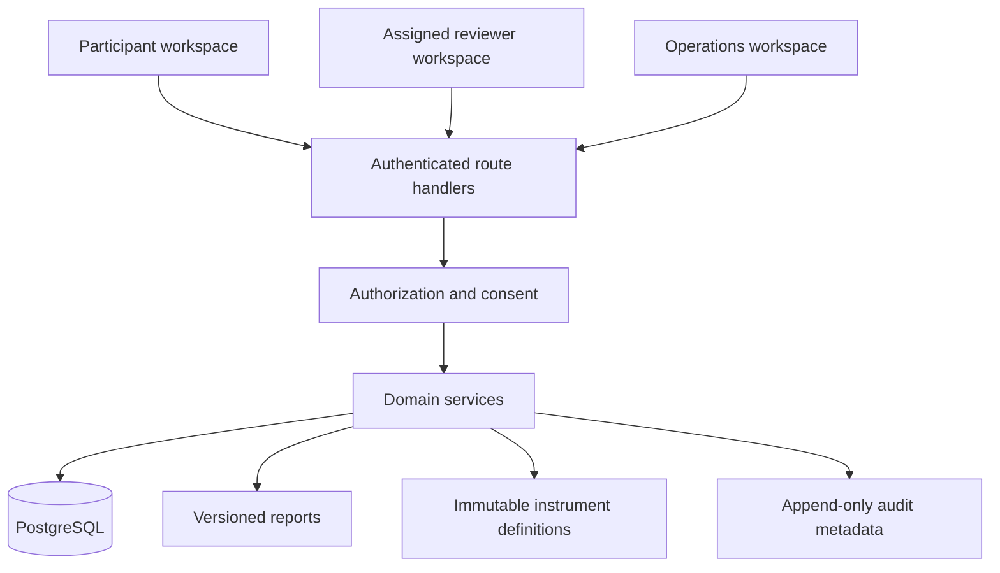

# Architecture and executive decisions

## Scope

Clearframe is an adult-only, single-organization modular monolith for organizing self-report and supporting assigned human review. Version 0.1 is a functional synthetic demonstration, not a clinical service. There is no autonomous interpretation, external AI, monitoring team, emergency outreach, or real-world screening measure.

## Data flow

Production PostgreSQL and local PGlite use the same Drizzle schema and SQL migrations. PGlite is embedded PostgreSQL-compatible storage, restricted to local single-process use. It is not a production substitute or a distributed database. Next development binds to loopback. No browser storage contains assessment responses.

## Technology choice

The requested Next.js App Router / React / strict TypeScript / Tailwind stack is retained. Drizzle replaces Prisma under the brief’s equivalent typed ORM option so the same schema can support embedded PostgreSQL-compatible demonstration storage and PostgreSQL deployment. Better Auth owns password hashing, sessions, CSRF checks for authentication, reset tokens, and TOTP. React Hook Form manages profile and login forms; the questionnaire has a schema-driven state machine and Zod-backed server validation.

## Trust boundaries

- `src/domain`: definitions, answer types, pure validation and completeness calculation, policy primitives.
- `src/db`: typed tables and database connection. `drizzle/` contains ordered migrations and integrity triggers.
- `src/server/access.ts`: database-derived identity/role, assignments, consent, adult eligibility, MFA enrollment requirement.
- `src/server/*-service.ts`: transactional application rules. Callers must supply an authenticated actor obtained by the route boundary; never expose these functions directly as user-callable server actions.
- `src/app/api/workspace/[...path]/route.ts`: strict mutation schemas, identity, rate limit, role rules, same-origin checks, safe errors.
- `src/components`: presentation and in-memory UI state. It never grants access.
- `src/lib/auth.ts`: maintained authentication library configuration and optional SMTP recovery.

## Concurrency and historical integrity

Each draft has an integer revision. Saves use compare-and-update; stale windows receive 409 instead of silently overwriting newer responses. Per-participant row locking serializes starts. Submission is keyed by the session ID, transactional, and idempotent after completion. Raw answers and derived completeness results are stored separately. Sessions reference immutable instrument versions.

Reports capture submitted responses at creation time. Later assessments do not silently change that snapshot. Draft saves use revisions. Finalization requires explicit review, limitations, and a follow-up plan. A database trigger rejects updates/deletes of finalized report versions. An amendment locks the report, creates the next version, and keeps the parent ID and reason. Internal notes are never copied into reports or participant exports.

Audit records are append-only and contain action identifiers, actor, resource identifiers, and timestamps. They do not contain answers or narrative text. Database owners can defeat database protections; operational permissions and external audit retention are still required.

## Non-goals and review boundaries

No multi-tenancy, minor participation, validated instruments, scored severity bands, AI summarization, crisis escalation, electronic-signature legal assurance, automated retention purge, or clinical billing. Browser-based Print / Save as PDF uses the accessible HTML report; there is no certified tagged-PDF generator.

Database-backed authorization is tested against embedded PostgreSQL. A dedicated GitHub Actions browser job exercises the external PostgreSQL path. This job was authored but not run in the authoring environment.
