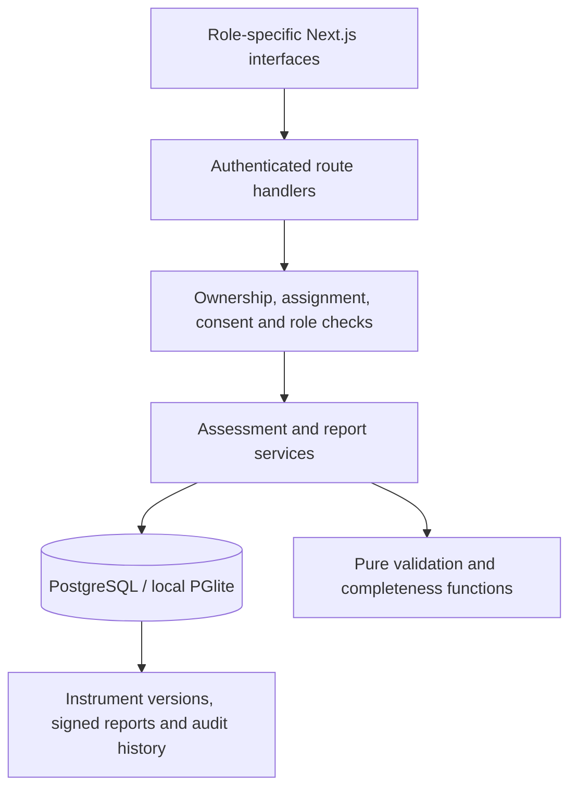

# Clearframe

**Assessment, in context.** An adult-only workspace for participant self-report, assigned professional review, and versioned reports.

> **Synthetic demonstration — not for clinical use.** Clearframe is not an autonomous psychologist, diagnostic system, validated screening service, or emergency service. Submissions are not monitored. Use synthetic information only.

## 1. Scope and assumptions

This repository delivers a working vertical slice across participant, reviewer, and operational administrator roles. It is a single-organization modular monolith, designed for code review and extension. The first release intentionally contains original demo questionnaires instead of unverified clinical instruments.

Executive decisions: Next.js App Router, strict TypeScript, React, Tailwind, Better Auth, Drizzle, PostgreSQL, React Hook Form, Zod, Vitest, and Playwright. Drizzle is the equivalent typed ORM substitution for Prisma; it enables a zero-server local PGlite demo while retaining PostgreSQL schema and migration compatibility. The application works without AI, email, or a paid service.

## 2. Clinical and safety boundaries

- Self-report, direct observations, third-party information, automated completeness calculations, and reviewer interpretation are distinct.
- Every included module and report is marked as a demonstration. No clinical score, severity cutoff, diagnosis, probability, or normative comparison is invented.
- Adult eligibility requires explicit self-attestation; minors are unsupported.
- Urgent help is public and persistent. There is no live monitoring, automatic outreach, or fabricated emergency number. The default is a local-emergency-services fallback; verified regional resources can be configured.
- Instrument permissions, clinical validity, professional credentials, legal consent, infrastructure security, and production suitability require independent review.

## 3. Architecture



See [architecture decisions](docs/ARCHITECTURE.md). Clinical data is stored server-side, never in browser localStorage. Demo PGlite is local and single-process only. Production requires PostgreSQL and external infrastructure controls.

## 4. File tree

```text
clearframe/
├── .github/                  CI, PostgreSQL browser job, Dependabot, issue/PR templates
├── drizzle/                  SQL migrations, integrity triggers, migration snapshots
├── docs/                     Architecture, instruments, security, deployment, verification
├── scripts/                  Local setup, migrations, seeds, provisioning, startup guard
├── src/
│   ├── app/                  Next.js pages, layouts, styles, authenticated API routes
│   ├── components/           Participant, questionnaire, reviewer, reports, operations UI
│   ├── db/                   Typed schema and database connection
│   ├── domain/               Answer types, registry, pure calculations, policy primitives
│   ├── lib/                  Authentication and typed client requests
│   └── server/               Authorization and transactional application services
├── tests/                    Domain, database, HTTP, report-rendering and browser tests
├── .env.example              Configuration names, no real secrets
├── compose.yml               Optional local PostgreSQL
├── package.json              Exact direct dependency versions
├── package-lock.json         Reproducible npm dependency graph
├── CONTRIBUTING.md
├── SECURITY.md
└── LICENSE                   MIT for code and original demo content
```

## 5. Implementation

### Participant

Explicit versioned consent → optional preferences → core intake or optional modules → autosaved draft → review-before-submit → read-only structured summary. Skip states remain distinct. Account settings support consent withdrawal, previewed JSON export, and deletion requests. Submitted assessments and finalized reports appear in history.

### Reviewer

Explicit assignments and active consent are required. Review original responses, missing states, versions, and nonclinical calculations. Add source-labeled internal notes. Create a structured report, enter mental-status observations manually, preview/print, explicitly finalize, and create amendments. No credentials are invented.

### Operations

Manage account availability, reviewer assignments, module recommendations, instrument availability, consent/retention settings, verified resource metadata, deletion-request review, and minimal audit history. This role has no automatic clinical-record access. Trusted operator scripts provision accounts; there is no public signup or role-change input.

### Selected versions

| Component                    | Version          |
| ---------------------------- | ---------------- |
| Next.js                      | 16.4.2           |
| React / React DOM            | 19.3.1           |
| TypeScript                   | 7.0.2            |
| Tailwind                     | 4.3.3            |
| Better Auth                  | 1.7.10           |
| Drizzle ORM / Kit            | 0.45.4 / 0.31.11 |
| PGlite                       | 0.5.10           |
| PostgreSQL deployment target | 17               |
| Zod / React Hook Form        | 4.6.7 / 7.90.0   |
| Vitest / Playwright          | 5.0.5 / 1.64.1   |

Versions were selected from the available package registry and pinned. See the lockfile for all transitive versions. A pinned esbuild override replaces an older Drizzle tooling dependency; its generation path is verified in the checks. Recheck advisories before deployment.

Primary integration references: [Next.js](https://nextjs.org/docs), [Better Auth installation](https://better-auth.com/docs/installation), [Better Auth Drizzle adapter](https://better-auth.com/docs/adapters/drizzle), [Drizzle PGlite](https://orm.drizzle.team/docs/get-started/pglite-new). Documentation is contextual guidance; the executed checks are recorded separately.

## 6. Database setup

The local setup command creates `.env` with a random secret, applies all migrations to `.local/database`, and inserts synthetic accounts and demo definitions. It is idempotent and does not overwrite existing responses or versions. Run setup with the dev server stopped so only one process owns the embedded database.

The schema contains 26 tables. Roles are server-owned user fields; item definitions live inside immutable instrument-version JSON; report amendments are new report-version rows with a parent ID and reason. These deliberate consolidations preserve explicit lifecycle and provenance without unnecessary tables.

To use external PostgreSQL locally instead:

```bash
export POSTGRES_PASSWORD='choose-a-local-only-database-password'
docker compose up -d postgres
# Set DATABASE_URL in .env to your PostgreSQL connection string.
npm run db:migrate
npm run db:seed
```

The seed requires `DEMO_MODE=true` and refuses production. Production initialization without sample accounts is `NODE_ENV=production npm run db:init`; follow the deployment checklist first. Schema changes use `npm run db:generate` and reviewed SQL migrations. Do not alter an already-applied migration.

## 7. Local run instructions

Requirements: Node 24 LTS (minimum 22.12), npm, and a modern browser. Docker is optional.

```bash
npm ci
npm run demo
```

Open **http://localhost:3000**. The development server binds to loopback. `npm run demo` runs setup then the development server. On later launches, use `npm run dev`. Do not run the demo using `npm start`; production startup deliberately rejects demo mode.

| Synthetic account            | Email                 | Password              |
| ---------------------------- | --------------------- | --------------------- |
| Participant                  | alex@demo.invalid     | Clearframe-demo-2026! |
| Assigned reviewer            | reviewer@demo.invalid | Clearframe-demo-2026! |
| Operations                   | admin@demo.invalid    | Clearframe-demo-2026! |
| Unassigned isolation fixture | jordan@demo.invalid   | Clearframe-demo-2026! |

These published credentials are restricted to local development. The seed makes no professional-credential claims. The delivered archive excludes `.env`, the database, installed dependencies, and build output.

### Put it on GitHub

Recommended repository name: **clearframe**. Start private until you have reviewed the source. This delivery is prepared for GitHub; it has not been uploaded or deployed.

After unzipping and opening the `clearframe` folder:

```bash
git init -b main
git add .
git commit -m "feat: add Clearframe assessment-support demo"
# With GitHub CLI installed and authenticated:
gh repo create clearframe --private --source=. --remote=origin --push
```

Alternatively create an empty private repository in GitHub, then add its remote and push. Never upload `node_modules`, `.next`, `.local`, `.env`, database dumps, or real assessment information. GitHub Actions runs unit/integration checks, a build, dependency audit, and a separate PostgreSQL-backed Playwright job. No static GitHub Pages deployment is configured because the app requires a server and protected database.

## 8. Demo walkthrough

1. Sign in as Alex. Review consent, check adult eligibility and consent explicitly, then save preferences.
2. Open **Your context & goals**. Enter synthetic concerns, skip optional details, and use **Save & pause**. Resume from Overview.
3. Review answers before submitting. The summary shows raw responses and completeness; it does not calculate a health score.
4. Sign out and sign in as the reviewer. Open Alex’s assigned record, review responses, and add an internal note with a source label.
5. Create a report. Enter your own demo narrative and observations. Document limitations and a follow-up plan, preview, attest review, and finalize. Create an amendment to demonstrate immutable history.
6. Return as Alex. See the finalized report, preview/download a JSON export, and verify internal notes are absent. Withdraw consent to pause reviewer access, or submit a deletion request.
7. Sign in as operations. Manage assignments, inspect registry provenance and audit metadata, and review privacy requests. Operations cannot open clinical responses.

## 9. Tests and actual execution status

```bash
npm run typecheck
npm test
npm run build
npm audit --omit=dev --audit-level=high
# Browser-capable environment:
npx playwright install chromium
npm run test:e2e
```

See [the verification record](docs/VERIFICATION.md) for actual results and unexecuted checks. Unit/integration tests use a fresh in-memory PostgreSQL-compatible database. They exercise real Better Auth and HTTP handlers as well as services. CI includes external PostgreSQL browser coverage, but a committed workflow is not proof that CI has run.

## 10. Security and privacy notes

See [security and privacy](docs/SECURITY-PRIVACY.md) and [security reporting](SECURITY.md). Implemented controls include database-derived roles, explicit assignments, consent checks, CSRF origin checks, strict validation, parameterized queries, escaped output, rate limits, revision checks, immutable signed versions, and content-free audit metadata.

Infrastructure encryption, backup handling, stronger CSP, independent penetration testing, revocation-race analysis, managed account recovery, and operational assurance remain. No regulatory compliance is claimed.

## 11. Clinical-review requirements

See [the clinical-review matrix](docs/CLINICAL-REVIEW.md) and [instrument registry/scoring specification](docs/INSTRUMENTS.md). Exact instruments, rights, scoring, intended use, consent, professional qualifications, safety protocols, and report-release policy require documented qualified review.

## 12. Remaining limitations

No validated clinical instruments, autonomous diagnosis, AI processing, minors, multi-tenancy, monitored crisis response, certified electronic signatures, automated data erasure, or retention scheduler. Generic clinician-only questionnaire editing and arbitrary calculated-field rendering are not implemented. HTML reports support browser Print / Save as PDF; dedicated accessible/tagged PDF generation is not included. See [the roadmap](docs/ROADMAP.md).

## 13. Production deployment checklist

Use [docs/DEPLOYMENT.md](docs/DEPLOYMENT.md). Production startup requires PostgreSQL, HTTPS, a random secret, no demo accounts, `DEMO_MODE=false`, and an explicit deployment-review acknowledgment. These guards do not certify clinical suitability or security. This release should remain a synthetic-data demonstration until the remaining work and reviews are completed.

## Feature status

| Feature                                         | Implemented status                       | Evidence                                            | Known limitation                                      | Additional review required         |
| ----------------------------------------------- | ---------------------------------------- | --------------------------------------------------- | ----------------------------------------------------- | ---------------------------------- |
| Adult consent and preferences                   | Implemented                              | `participant-pages.tsx`, `workspace-service.ts`     | Self-attestation; configurable terms                  | Clinical/legal                     |
| Drafts, resume, conditional prompts, submission | Implemented                              | `questionnaire.tsx`, `assessment-service.ts`        | Generic clinician/calculated field UI incomplete      | UX/accessibility                   |
| 17 topic modules                                | Demo implemented                         | `domain/registry.ts`                                | Unvalidated conversation guides                       | Instrument rights/clinical         |
| Clinical scoring                                | Not implemented                          | `domain/assessment.ts` always returns `score: null` | Completeness only                                     | Verified scoring required          |
| Role and assignment isolation                   | Implemented and tested                   | `access.ts`, `workflows.test.ts`                    | Single organization; revocation races not proven      | Security                           |
| Reviewer notes and structured observations      | Implemented                              | `participant-detail.tsx`, `report.tsx`              | Credentials not independently verified                | Clinical                           |
| Versioned reports and amendments                | Implemented and tested                   | `report-service.ts`, SQL triggers                   | Application signature only                            | Clinical/legal                     |
| HTML / printable PDF                            | HTML + browser printing implemented      | `report.tsx`, print CSS                             | No certified tagged-PDF generator                     | Accessibility                      |
| Export and deletion request                     | Export/request/review implemented        | `workspace-service.ts`, account/admin screens       | Actual erasure and backup expiry manual               | Privacy/legal                      |
| Admin settings, assignments, registry, audit    | Implemented                              | `admin-page.tsx`, `admin-service.ts`                | Provisioning via trusted CLI; latest 100 audit events | Operations/security                |
| Authentication, TOTP, recovery                  | Implemented; basic auth tested           | `lib/auth.ts`, account/sign-in screens              | SMTP and full MFA browser flow not locally tested     | Security                           |
| Urgent resources                                | Public fallback + configurable directory | `urgent-help/page.tsx`                              | No verified regional entries seeded; no monitoring    | Clinical/local verification        |
| Automated tests and GitHub CI                   | 55 local tests; CI authored              | `tests/`, `.github/workflows/ci.yml`                | Browser CI not run here                               | Browser/PostgreSQL checks          |
| Accessibility                                   | Practices implemented; checks authored   | Semantic UI, axe Playwright tests                   | No completed accessibility audit                      | Manual + automated audit           |
| Production clinical service                     | Not approved or deployed                 | Deployment and review documents                     | Substantial independent review remains                | Clinical/legal/security/operations |
